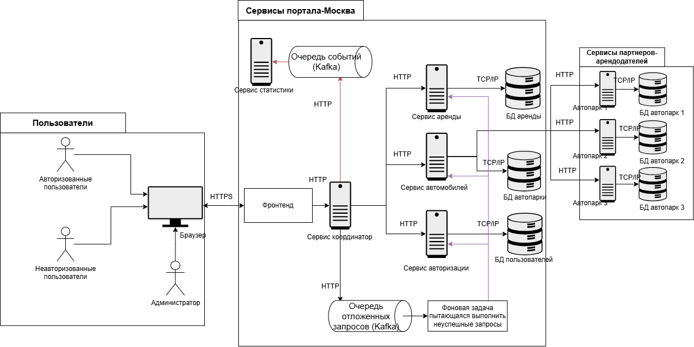
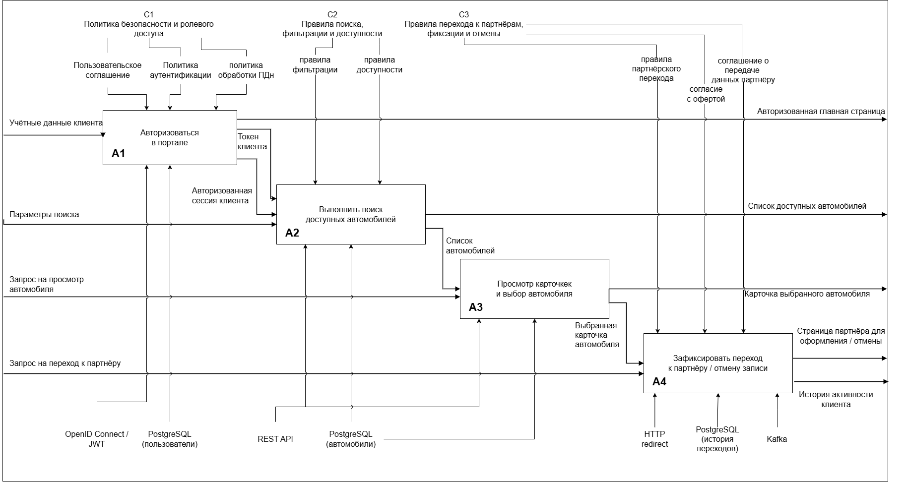

# Веб-портал бронирования автомобилей — проектирование

Техническое задание и проектная документация агрегатора аренды автомобилей в Москве.
Работа по дисциплине «Методология программной инженерии», кафедра ИУ7, магистратура МГТУ им. Н.Э. Баумана (весна 2026), преподаватель Романова Т.Н.

## Идея

Портал сам не сдаёт машины в аренду. Пользователь задаёт класс автомобиля, район получения, даты и бюджет, а портал собирает предложения нескольких партнёров-арендодателей, сортирует их по релевантности и перенаправляет на сайт партнёра для оформления и оплаты.
В первой версии охвачены три зоны Москвы: северная, юго-западная и восточная.

## Документы

- **[Техническое задание (PDF, 71 стр.)](docs/technical-specification.pdf)** — глоссарий, требования к порталу, сценарии взаимодействия подсистем, подробные варианты использования для пользователя, клиента и администратора, все диаграммы ниже.
- **[Прототип интерфейса](prototype/CarRentalPortal.jsx)** — React-компонент: поиск и фильтры, карточки автомобилей, окно входа и регистрации, личный кабинет клиента с историей и избранным.

## Архитектура

Фронтенд → сервис-координатор → сервисы аренды, автомобилей и авторизации со своими БД. Автопарки партнёров подключаются по HTTP. События уходят в Kafka для сервиса статистики, неуспешные запросы — в очередь отложенных запросов с фоновым повтором.

## Диаграммы

| Вид | Файлы | Что показывает |
|---|---|---|
| Варианты использования (UML) | [use-case](diagrams/use-case) | пользователь, клиент и администратор: поиск, просмотр автомобилей и партнёров, регистрация, авторизация, логи |
| IDEF0 | [idef0](diagrams/idef0) | контекстная диаграмма A-0, декомпозиция A0 и детализация сценария клиента: авторизация → поиск → выбор → переход к партнёру |
| Потоки данных (DFD) | [dfd](diagrams/dfd) | движение данных между пользователем, подсистемами и хранилищами |
| Классы (UML) | [class](diagrams/class) | доменная модель портала |
| Последовательности (UML) | [sequence](diagrams/sequence) | поиск автомобиля и переход на сайт партнёра через подсистемы фронтенда, координатора, автомобилей и аренды |

Исходники всех диаграмм — `.drawio`, их можно открыть на [app.diagrams.net](https://app.diagrams.net) или в расширении draw.io для VS Code.

## Как посмотреть прототип

Компонент рассчитан на React + Tailwind CSS + [shadcn/ui](https://ui.shadcn.com) (`Button`, `Card`) и `framer-motion`. Проще всего вставить его в проект, созданный по инструкции shadcn/ui для Vite, и отрендерить `CarRentalPortalDesign` как страницу.

## Автор

Салженикин Даниил, группа ИУ7-21М, МГТУ им. Н.Э. Баумана.
